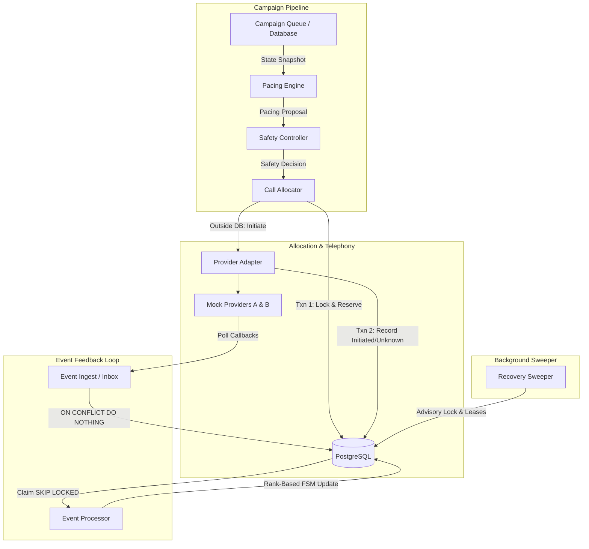
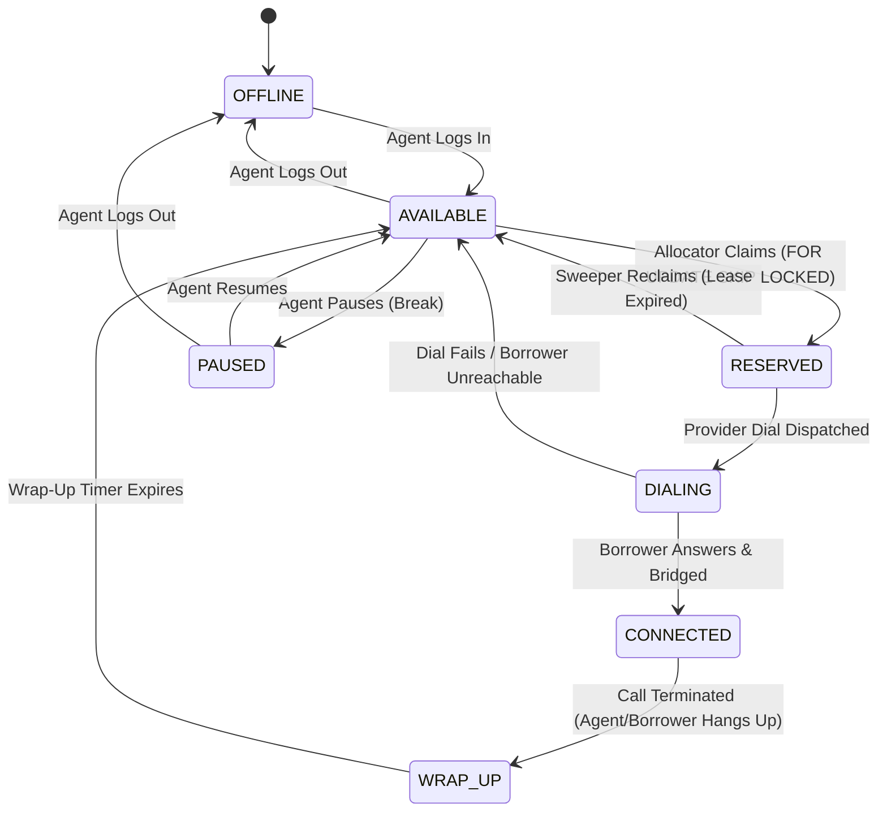
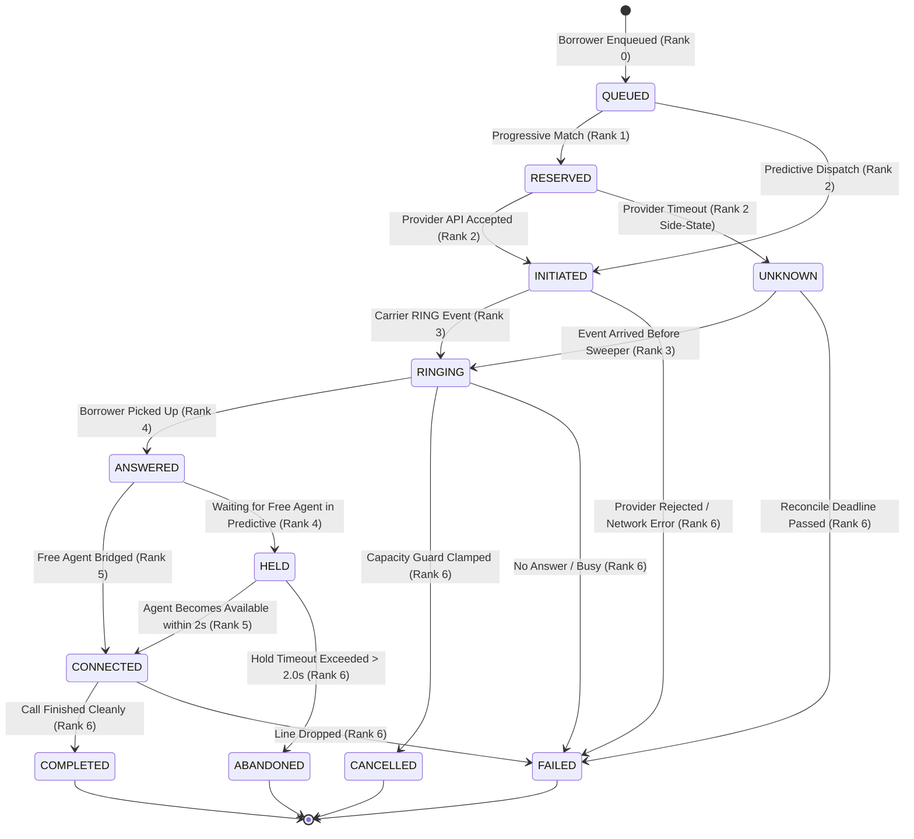
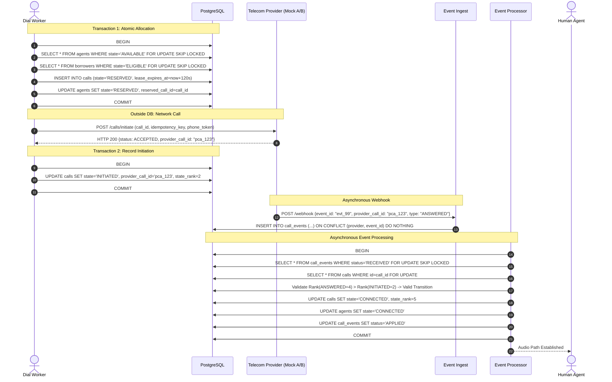

# SmartDialer Architecture & State Machines

This document provides a comprehensive technical reference for the SmartDialer architecture, its discrete state machines, transaction boundaries, and concurrency semantics.

---

## 1. High-Level Component Flow

The system operates as a stateless data pipeline where PostgreSQL acts as the single source of truth. Every worker thread is stateless, owns its own database session, and never communicates with peers via shared memory.



### Architectural Principles:
1. **Postgres as Single Source of Truth**: All queue state, agent availability, and call lifecycles live exclusively in relational tables.
2. **Deterministic Safety Boundary**: The Pacing Engine *proposes* dials using statistical upper bounds ($p_{hi}$), but the deterministic Safety Controller *disposes* (enforcing hard agent caps, overdial boundaries, circuit breakers, and abandonment hysteresis).
3. **Provider Calls Outside Transactions**: Zero telecom API calls happen inside a PostgreSQL transaction.
4. **Idempotent Ingestion + Monotonic Processing**: Out-of-order and duplicate provider events are absorbed safely by rank-based state machines without table corruption.

---

## 2. Agent State Machine

Agents transition through a cyclical work loop managed by row-level versioning and lease expirations.



### State Definitions & Guards:
- **`AVAILABLE`**: Eligible for immediate matching by `reserve_for_progressive` or answer-time matching in predictive mode.
- **`RESERVED`**: Locked to a specific call. Holds `reserved_call_id` and `reservation_expires_at` (30s TTL). If the worker crashes before dialing, the Recovery Sweeper releases the agent back to `AVAILABLE`.
- **`CONNECTED`**: Actively talking to a borrower.
- **`WRAP_UP`**: Post-call notes. Handled with configured duration (`wrap_up_seconds`), transitioning automatically back to `AVAILABLE`.
- **`PAUSED`**: Agent temporarily unavailable for dispatch.

---

## 3. Call State Machine (Rank-Based Monotonic FSM)

To prevent late or out-of-order telecom webhooks from corrupting call records, state transitions follow an integer rank hierarchy: $\text{Rank}(S_{\text{new}}) > \text{Rank}(S_{\text{current}})$. Terminal states absorb all subsequent events.



### State Ranks:
| Rank | State | Category | Description |
|---|---|---|---|
| **0** | `QUEUED` | Initial | Record created in DB. |
| **1** | `RESERVED` | Pre-Dial | Agent locked for progressive dial. |
| **2** | `INITIATED` | In-Flight | Provider confirmed initiation HTTP call. |
| **2** | `UNKNOWN` | Ambiguous | Provider timed out; await webhook or sweeper reconciliation. |
| **3** | `RINGING` | Carrier | Borrower handset ringing. |
| **4** | `ANSWERED` | Telecom | Handset lifted; awaiting bridge to agent. |
| **4** | `HELD` | Predictive | Handset lifted; queued on short hold ($\le 2.0$s) awaiting agent. |
| **5** | `CONNECTED` | Active | Borrower bridged with human agent. |
| **6** | `COMPLETED` | Terminal | Clean hangup after conversation. |
| **6** | `FAILED` | Terminal | Busy, carrier failure, or no-answer. |
| **6** | `CANCELLED` | Terminal | Excess ringing call terminated by safety/capacity guard. |
| **6** | `ABANDONED` | Terminal | Answered call exceeded hold timeout without agent. |

---

## 4. End-to-End Call Execution Sequence

Illustrates the strict 3-step pattern separating database transactions from external telecom requests:



---

## 5. Two-Worker Concurrency Race with `SKIP LOCKED`

Illustrates why two concurrent worker threads can never allocate the same agent or borrower, and why no deadlocks occur:

```mermaid
sequenceDiagram
    autonumber
    actor W1 as Worker 1
    actor W2 as Worker 2
    participant DB as PostgreSQL (agents table)

    Note over W1,W2: Both workers tick at the same millisecond
    W1->>DB: BEGIN (READ COMMITTED)
    W2->>DB: BEGIN (READ COMMITTED)

    W1->>DB: SELECT id FROM agents WHERE state='AVAILABLE' ORDER BY last_state_change_at LIMIT 1 FOR UPDATE SKIP LOCKED
    Note over DB: Postgres acquires Exclusive Row Lock on Agent 101 for Worker 1
    DB-->>W1: Returns [Agent 101]

    W2->>DB: SELECT id FROM agents WHERE state='AVAILABLE' ORDER BY last_state_change_at LIMIT 1 FOR UPDATE SKIP LOCKED
    Note over DB: Postgres sees Agent 101 locked; SKIPS Agent 101 immediately!
    Note over DB: Postgres acquires Exclusive Row Lock on Agent 102 for Worker 2
    DB-->>W2: Returns [Agent 102]

    W1->>DB: UPDATE agents SET state='RESERVED' WHERE id=101
    W1->>DB: INSERT INTO calls (agent_id=101, state='RESERVED')
    W1->>DB: COMMIT (Locks released)

    W2->>DB: UPDATE agents SET state='RESERVED' WHERE id=102
    W2->>DB: INSERT INTO calls (agent_id=102, state='RESERVED')
    W2->>DB: COMMIT (Locks released)

    Note over W1,W2: Zero lock waiting, zero deadlocks, zero double-allocation
```
